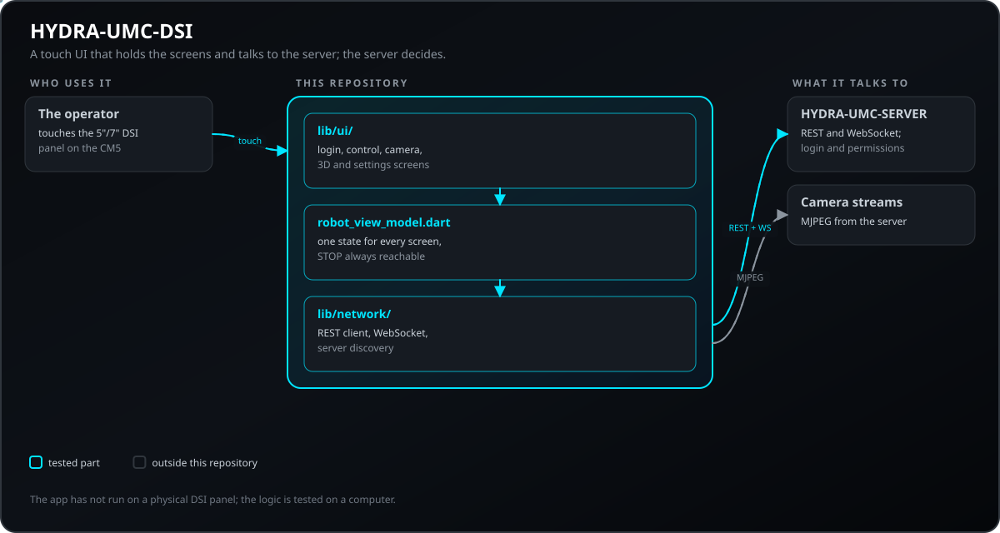
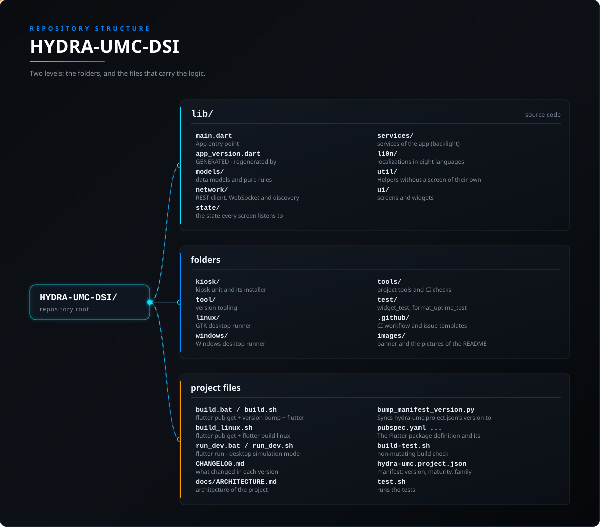

<!-- =============================================================================
HYDRA-UMC-DSI - Native touch UI for the CM5 DSI screen
Copyright (C) JuanenRac (Electro Hobby 3D) <electrohobby3d@gmail.com>
GPL-3.0-or-later - see LICENSE
============================================================================= -->

<p align="center">
  
</p>

# 🖥️ HYDRA-UMC-DSI

<p align="center"><a href="README.md">🇺🇸 English</a> | <a href="README_spa.md">🇪🇸 Español</a> | <a href="README_fra.md">🇫🇷 Français</a> | <a href="README_ita.md">🇮🇹 Italiano</a> | <a href="README_deu.md">🇩🇪 Deutsch</a> | <a href="README_zho.md">🇨🇳 简体中文</a> | <a href="README_jpn.md">🇯🇵 日本語</a> | 🇵🇹 <b>Português</b></p>

### Uma interface tátil nativa para o ecrã DSI do Compute Module 5

<p align="center">
  
  
  
  
  
  
  
</p>

---

Uma interface tátil Flutter nativa (Dart, alvo real de desktop Linux) para o ecrã tátil DSI de 5"/7" do próprio HYDRA-UMC no Compute Module 5 - os dois tamanhos físicos de painel partilham exatamente a mesma resolução de 1280x720 píxeis, pelo que esta aplicação traz um único esquema fixo e não responsivo em vez de se adaptar a dois tamanhos. Fala exatamente o mesmo contrato [`REMOTE_API.md`](https://github.com/JuanenRac/HYDRA-UMC-SERVER/blob/main/docs/REMOTE_API.md) que o [HYDRA-UMC SUITE](https://github.com/JuanenRac/HYDRA-UMC-SUITE), o [HYDRA-UMC-ANDROID-CONTROL](https://github.com/JuanenRac/HYDRA-UMC-ANDROID-CONTROL) e o [HYDRA-UMC-IOS-CONTROL](https://github.com/JuanenRac/HYDRA-UMC-IOS-CONTROL) usam - descoberta, início de sessão, comandos atómicos por robô e sincronização WebSocket em direto contra um servidor [HYDRA-UMC-SERVER](https://github.com/JuanenRac/HYDRA-UMC-SERVER) em execução, correndo diretamente na própria placa e não num separador do navegador. Veja [`docs/ARCHITECTURE.md`](docs/ARCHITECTURE.md) para o desenho completo, incluindo porque é Flutter (e não Kivy) e porque é que o ecrã 3D não é uma WebView.

**Esta aplicação é uma de duas superfícies de controlo que coexistem na mesma placa** - o CM5 também alimenta uma saída HDMI para um monitor externo completo que corre a interface do navegador. Esta aplicação DSI complementa esse caminho com uma consola tátil direta e sempre ligada na própria placa; não substitui a interface do navegador.

---

**Verificação de honestidade - o que realmente funciona hoje:** a camada de rede (`lib/network/hydra_api_client.dart`, `hydra_websocket.dart`, `discovery.dart`, `auth_prefs.dart`) e a camada de estado (`lib/state/robot_view_model.dart`, `hydra_error.dart`) são reais e estão testadas (174 testes a passar em `test/*.dart`, incluindo uma volta real de ligação/religação/rejeição de autenticação por WebSocket contra um servidor local genuíno, não um simulado), e o `flutter analyze` não reporta problemas. Os 6 ecrãs do catálogo são interface real e ligada, não marcadores de posição. O que genuinamente não está construído: o ecrã **Vista 3D** é um pequeno indicador isométrico X/Y/Z nativo, não um renderizador 3D real - não embebe a cena Three.js do STUDIO (não existe nenhuma implementação de `webview_flutter` para Linux). O que é real mas não está verificado no hardware de destino: o `flutter build linux --release` foi executado e produz um binário cujo arranque está confirmado, mas apenas em Ubuntu 24.04 WSL2 (x86_64) - nunca no Raspberry Pi OS aarch64 real do CM5 - e a unidade de arranque automático `kiosk/hydra-umc-dsi.service` nunca correu em nenhuma máquina Linux real. Veja "Seguimentos conhecidos" abaixo e o `CHANGELOG.md` para saber exatamente o que foi entregue até agora.

> **Estado de segurança (safety e security):** este ecossistema não é um sistema de segurança certificado. Ainda não existe um caminho de E-STOP por hardware, nem limites ou interlocks impostos pelo firmware, nem um comando de movimento verificado; as imagens de firmware são verificadas com CRC-32 e uma assinatura Ed25519, e uma compilação de versão recusa as chaves de desenvolvimento publicadas (as cabeças de ferramenta e as placas de expansão atrás do relé ainda usam os bootloaders do URTC, que aceitam um HMAC-SHA256 de chave partilhada em vez de uma assinatura); TLS e TLS mútuo são opcionais e estão desativados por defeito; nenhuma placa própria foi ainda montada ou testada. Leia a [base de segurança](https://github.com/JuanenRac/HYDRA-UMC-DOCS/blob/main/docs/SECURITY_BASELINE.md) e o [modelo de ameaças](https://github.com/JuanenRac/HYDRA-UMC-DOCS/blob/main/docs/THREAT_MODEL.md) antes de confiar em qualquer afirmação aqui para a segurança de uma pessoa.

---

## 📋 Num relance

| | |
|---|---|
| Versão | `0.2.7` |
| Maturidade | Funcional |
| Testes | 174 (`flutter test`) |
| Tecnologia | Flutter 3.x / Dart |
| Destino | O Raspberry Pi CM5 de uma célula HYDRA-UMC |
| Em hardware real | Ainda não: não há registo de execução em hardware real para esta versão |

**Ir para:** [Visão geral](#-visão-geral) · [Arquitetura](#-arquitetura) · [Início rápido](#-início-rápido) · [Testes](#-testes) · [Estrutura do repositório](#-estrutura-do-repositório) · [Projetos relacionados](#-projetos-relacionados)

## 🚦 Estado do projeto

Cada linha é uma parte deste repositório e a luz diz até onde chega hoje. É escrita com o que o repositório consegue demonstrar (testes, compilações, execuções), não com o que está previsto.

🟢 Feito e verificado · 🟡 Funciona, com limites conhecidos · 🟠 Feito a meio ou ainda por verificar · 🔴 Por fazer ou a não funcionar

| Área | Estado | O que significa aqui |
|---|---|---|
| Software | 🟡 | Funciona para o seu propósito principal; a verificação de honestidade acima lista o que ainda falta |
| Testes | 🟢 | 174 testes automáticos, executados a cada alteração |
| Hardware real | 🔴 | Ainda não: não há registo de execução em hardware real para esta versão |
| Documentação | 🟢 | README em oito idiomas, verificado contra o manifesto a cada alteração |

## 🎯 Visão geral

- **Início de sessão** (`lib/ui/login_screen.dart`, `lib/state/robot_view_model.dart`) - campos de IP/porta do servidor pré-preenchidos com um valor de LAN sensato, campos de utilizador/palavra-passe dimensionados para toque e deixados em branco por omissão (nenhuma credencial fixa vem pré-preenchida - o pré-preenchimento inicial `admin`/`admin` foi retirado quando todos os servidores passaram a recusar criar essa conta por omissão no primeiro arranque real de produção), `POST /api/login` contra a conta que o operador introduzir; podem criar-se contas de "operador" com menos privilégios em Config > Users na interface do navegador. O token de sessão fica no armazenamento seguro da plataforma (libsecret no Linux, que exige um serviço de porta-chaves em execução: num painel sem ele a sessão dura até reiniciar a aplicação e o início de sessão volta a ser pedido). Um diálogo "Procurar na rede local" (`lib/network/discovery.dart`) encontra servidores sem ser preciso conhecer já o IP - duplamente útil aqui, já que o CM5 em que esta aplicação corre é muitas vezes o próprio controlador a que se deve ligar.
- **Descoberta de rede** (`lib/network/discovery.dart`) - dois caminhos correm em paralelo a partir do mesmo diálogo "Procurar na rede local": mDNS/Bonjour real (`discoverMdns()`, que consulta a publicação `_hydra._tcp` do próprio `server.ts` através do pacote `multicast_dns`) e uma pesquisa concorrente por força bruta de `GET /api/hydra-info` na(s) sub-rede(s) local(is) real(is) deste dispositivo (`scanSubnets()`), desduplicada por anfitrião:porta - portada do HYDRA-UMC-IOS-CONTROL, o primeiro cliente deste ecossistema a acrescentar descoberta mDNS real.
- **Sincronização atómica de comandos** (o próprio `_sendAtomicCommand()` de `lib/state/robot_view_model.dart`) - cada escrita (ativar/desativar/play/pausa/stop/jog/válvula/bomba/velocidade/visão) usa o endpoint real `POST /api/robot/:id/command`, com propagação correta de robôs combinados (`combinedWith`) e uma reversão para o instantâneo anterior à mutação se o pedido falhar - especialmente importante para um pendente de jog/E-STOP a poucos metros dos robôs reais.
- **Sincronização WebSocket em direto** (`lib/network/hydra_websocket.dart`) - envia o token como subprotocolo `hydra.bearer` e nunca no endereço, trata os dois tipos de difusão `"settings"` e `"delta"` e volta a ligar-se automaticamente quando cai.
- **Navegação tátil horizontal** (`lib/ui/main_screen.dart`) - uma barra superior persistente de 6 separadores grandes de ícone+etiqueta (Painel/Controlo/Câmara/Vista 3D/Métricas/Definições) ao longo dos 1280px fixos de largura, no espírito do KlipperScreen e não uma barra de navegação inferior ao estilo de telemóvel - de acordo com o catálogo que o dono do projeto pediu, reorganizado para um painel tátil largo em vez de um esquema vertical de telemóvel.
- **Painel** (`lib/ui/dashboard_screen.dart`) - cartões por robô, reativos em tempo real através de `Provider`, convenção de LED (verde a pulsar = ativo, vermelho fixo = inativo), apresentação de robôs combinados e chips de módulo (CAM/XY/ATC/PNP/CNC/LSR/BED/VAC/RCK) - a mesma linguagem visual de todos os outros clientes deste ecossistema.
- **Controlo manual** (`lib/ui/control_screen.dart`, `lib/ui/widgets/joystick_pad.dart`) - esquema lado a lado (teclado de jog à esquerda, telemetria/velocidade/E-S à direita) dimensionado para o quadro de 1280x720 em vez de uma única coluna com deslocação, o **STOP** global (`lib/ui/widgets/stop_all.dart`) na barra superior de cada separador, também no de Controlo e na sobreposição de limpeza do ecrã: um só toque, sem pressão longa nem confirmação, pára todos os robôs (`POST /api/stop-all`), mostra o resultado robô a robô (aviso se um robô falhou ou a paragem não foi guardada, robôs reservados por outra conta assinalados), repete uma vez após um erro de rede, recorre à paragem por robô perante um 429 ou um servidor mais antigo e mantém um aviso permanente «STOP não confirmado» até um STOP posterior obter resposta (o botão redondo de paragem por robô mantém a sua proteção de pressão longa), controlos deslizantes de velocidade/aceleração e interruptores de válvula/bomba.
- **Reservas e limites de segurança** (`lib/ui/widgets/access_panel.dart`, `lib/models/access.dart`, `lib/network/hydra_api_client.dart`, `lib/state/robot_view_model.dart`) - O ecrã Control mostra quem detém o robô selecionado (ninguém, este dispositivo, a mesma conta noutro dispositivo ou outra conta) e oferece **Reservar** e **Libertar**, além da lista de todas as reservas do servidor (`GET /api/claims`). O dispositivo guarda um identificador de controlador por instalação e envia-o com cada reserva, libertação, armamento do jog e comando (no corpo e no cabeçalho `X-Controller-Id`), pelo que a reserva pertence à conta e a este dispositivo, não a toda a conta. As recusas do servidor distinguem-se: reservado por outra conta, pela sua conta noutro dispositivo ou janela, identificador de controlador obrigatório e jog não armado. Os limites do modelo do robô são lidos de `GET /api/safety-limits`: um passo de jog acima do limite não é enviado e os avisos do servidor são mostrados. Quando o administrador o exige, é preciso premir **Armar o jog** (com contagem decrescente) antes de o joystick mover o robô; o armamento termina sozinho, com STOP ou ao libertar. As reservas são opcionais: um robô que ninguém reservou é comandado como antes. Apenas para um **administrador**, aparece um botão **Assumir o controlo** num robô que outra pessoa tem; pede confirmação e depois reserva o robô com `force: true` (o servidor só o aceita de administradores e volta a verificar o papel). As escritas são condicionais: cada uma leva a revisão do robô que esta app viu pela última vez (`If-Match`, `lib/models/contract_v2.dart`); se outra pessoa mudou o robô entretanto, o servidor responde 412, nada é aplicado, o robô é lido de novo e a mensagem di-lo (o modo Padrão verifica reservas, mesa e comandos pontuais; o Estrito verifica tudo exceto STOP; o Desligado não verifica nada; a escolha está na lista de reservas; o STOP nunca é verificado). O jog da mesa XY é um único comando atómico `table` (um servidor mais antigo recebe os jogs que entende), o servidor envia as reservas pelo WebSocket para o ecrã Control deixar de consultar enquanto chegam, e os administradores leem o registo de auditoria (`lib/ui/widgets/audit_dialog.dart`) com a cadeia SHA-256 verificada duas vezes, pelo servidor e no computador, e podem copiar as suas linhas como `.jsonl`.
- **Perguntar antes de PLAY** - ativado por defeito, desativa-se nas Definições: antes de iniciar uma trajetória a app mostra o robô, os seus pontos gravados, a velocidade e quem o tem reservado (um robô reservado por outra pessoa avisa que o servidor vai recusar o comando). Um robô que já está a reproduzir não volta a perguntar. A escolha fica guardada.
- **Câmara** (`lib/ui/camera_screen.dart`, `lib/ui/widgets/mjpeg_view.dart`) - o mesmo analisador de fluxo MJPEG feito à mão e sem dependências que o HYDRA-UMC-IOS-CONTROL (sem WebView, sem código específico de plataforma - funciona sem alterações em desktop Linux), um estado claro de "Câmara desativada" e um interruptor para ligar/desligar o sistema de visão de um robô diretamente a partir do servidor.
- **Vista 3D** (`lib/ui/three_d_screen.dart`) - **não** é uma WebView com a cena Three.js real do STUDIO, ao contrário das aplicações iOS/Android - o `webview_flutter` não tem qualquer implementação para desktop Linux, e um motor de navegador completo é uma carga de execução mais pesada do que este painel embebido de baixo consumo precisa. Em vez disso: um pequeno indicador isométrico nativo de posição X/Y/Z (`CustomPainter`, sem motor 3D), com uma nota no ecrã que aponta para a cena 3D real no monitor ligado por HDMI desta mesma placa. Veja `docs/ARCHITECTURE.md`, secção 4, para o raciocínio completo.
- **Métricas do sistema** (`lib/ui/metrics_screen.dart`) - o seu próprio separador dedicado (não integrado no Painel como fazem o iOS/Android) com mosaicos de CPU/memória/temperatura/tempo ativo a partir de `GET /api/system/metrics`, mais nome do anfitrião/número de controladores/número de robôs/versão da aplicação a partir de `GET /api/hydra-info`.
- **Definições** (`lib/ui/settings_screen.dart`) - informação da ligação, identidade do servidor, terminar sessão e a versão desta própria aplicação (veja [Versionamento](#-versionamento) abaixo).
- **Arranque automático em quiosque** (`kiosk/hydra-umc-dsi.service`, `kiosk/install_kiosk.sh`) - unidade systemd que lança a aplicação em ecrã inteiro no `tty1` através do `cage`, com `Restart=always`. Veja "Execução no CM5 real" abaixo.
- **Interface em 8 idiomas** (`lib/l10n/`, pipeline padrão `flutter gen-l10n`) - inglês, espanhol, francês, alemão, italiano, japonês, chinês e português, a par de todos os outros clientes deste ecossistema. Uma substituição persistente em `Definições > Idioma` assume por omissão o idioma do sistema operativo; `RobotViewModel.lastError` é um `HydraError` tipado e não texto inglês já formatado, pelo que as mensagens de erro da lógica de negócio também ficam localizadas, e não apenas o aspeto estático dos ecrãs.

**Estado: estrutura base + os 6 ecrãs do catálogo implementados e ligados ao contrato real do REMOTE_API.md.** `flutter analyze` limpo, `flutter build windows` e `flutter build linux` (via WSL2) produzem ambos um binário que arranca, `flutter test` passa - veja "Compilação" abaixo para saber exatamente o que foi e não foi verificado, incluindo a lacuna que resta entre esta verificação em WSL2 e o hardware CM5 real.

## 🧩 Papel no HYDRA-UMC

O **HYDRA-UMC-DSI** é o ecrã tátil da própria CM5: uma aplicação Flutter nativa para o painel DSI de 5"/7" que fala com o `HYDRA-UMC-SERVER` pela sua interface REST e WebSocket, ao lado da interface de navegador do `HYDRA-UMC-STUDIO`. Não tem lógica de robôs própria; o servidor decide o que é permitido.

## 🏛️ Arquitetura

<p align="center">
  
</p>

## 🚀 Início rápido

Requer o SDK Flutter estável (3.x) com suporte para ambiente de trabalho Linux.

```bash
flutter pub get
./run_dev.sh      # desktop simulation, no hardware (run_dev.bat on Windows)
./build_linux.sh  # on a Linux machine or the CM5: the real target
```

## 🧪 Testes

174 testes automáticos correm com `flutter test`. Não precisam de hardware nem de nada fora desta máquina.

A CI executa `HYDRA_UMC_CI=1 python tools/ci_validate.py`, que verifica o manifesto, os documentos, os oito README e as imagens.

## 🏗️ Compilação e publicação

Requer o [SDK do Flutter](https://docs.flutter.dev/get-started/install) (canal stable). Este repositório é compilado/verificado com o Flutter 3.47.0. Só `linux/` e `windows/` estão configurados como plataformas neste repositório (sem pastas `android/`, `ios/`, `web/` nem `macos/`) - o Linux é o alvo real (o próprio sistema operativo do CM5); o Windows existe apenas para que a lógica desta aplicação possa ser compilada, executada e testada numa máquina sem cadeia de ferramentas Linux.

### Scripts de compilação

```bash
./build.sh          # Git Bash / WSL, ou build.bat para cmd/PowerShell - flutter pub get + flutter build windows (verificação na máquina de desenvolvimento)
./build_linux.sh    # Tem de correr NUM Linux real (ou no próprio CM5) - flutter pub get + flutter build linux (o alvo de implementação real)
./run_dev.sh         # Git Bash / WSL, ou run_dev.bat para cmd/PowerShell - modo de simulação de desktop (flutter run), sem hardware
```

Os 3 scripts de compilação (`build.sh`/`build.bat`/`build_linux.sh`) não alteram a versão da aplicação - veja [Versionamento](#-versionamento) abaixo. `run_dev.sh`/`run_dev.bat` não o fazem - um `flutter run` do ciclo de desenvolvimento não é uma "compilação real" segundo essa política.

### Compilação manual

```bash
flutter pub get
flutter analyze                  # análise estática - sem necessidade de compilador
flutter test                     # testes de widgets
dart run tool/bump_version.dart  # sobe a versão, tal como o build.sh/build.bat/build_linux.sh fazem
flutter build windows            # teste rápido na máquina de desenvolvimento - produz build/windows/x64/runner/Release/hydra_umc_dsi.exe
flutter build linux              # o alvo REAL - tem de correr num Linux real, produz build/linux/*/release/bundle/
flutter run -d windows           # ou -d linux num Linux real, para um ciclo de desenvolvimento com simulação de desktop em direto
```

**Nota de honestidade sobre a verificação em Linux:** o `flutter build linux --release` foi já realmente executado contra este código, a partir de um ambiente Ubuntu 24.04 WSL2 real com uma cadeia de ferramentas de desktop Linux real (`cmake`, `ninja-build`, `libgtk-3-dev`, `clang`) - compila limpo e produz um `build/linux/x64/release/bundle/hydra_umc_dsi` genuíno, cujo arranque está confirmado (correu sob um ecrã X11 real e manteve-se vivo, não apenas um código de saída a passar), e não apenas o `flutter build windows` como substituto do teste rápido. O que isto **não** cobre: o espaço de utilizador do WSL2 é x86_64, não o Raspberry Pi OS aarch64 real do CM5, e o fluxo de arranque automático de `kiosk/hydra-umc-dsi.service` continua a nunca ter corrido em nenhuma caixa Linux real. Veja `docs/ARCHITECTURE.md`, secção 7, para a lista exata do que foi e não foi verificado, e "Seguimentos conhecidos" abaixo para o que falta.

## 📂 Estrutura do repositório

<p align="center">
  
</p>

<details>
<summary>Versão em texto da árvore</summary>

```text
HYDRA-UMC-DSI/
├── lib/                                                              código-fonte
│   ├── main.dart                                                     Ponto de entrada da aplicação, ChangeNotifierProvider + porta de início de sessão, tema escuro fixo
│   ├── app_version.dart                                              GERADO - regenerado por tool/bump_version.dart, não editar à mão
│   ├── models/                                                       modelos de dados e regras puras
│   ├── network/                                                      cliente REST, WebSocket e descoberta
│   ├── state/                                                        o estado que cada ecrã escuta
│   ├── services/                                                     serviços da aplicação (retroiluminação)
│   ├── l10n/                                                         localizações em oito idiomas
│   ├── util/                                                         Utilitários sem ecrã próprio
│   └── ui/                                                           ecrãs e widgets
├── kiosk/                                                            unidade de quiosque e o seu instalador
├── tool/                                                             ferramenta de versões
├── linux/                                                            Executor GTK de desktop - o alvo REAL, janela fixa de 1280x720
├── windows/                                                          Executor de desktop Windows - apenas verificação na máquina de desenvolvimento
├── tools/                                                            ferramentas do projeto e verificações da CI
├── test/                                                             widget_test, format_uptime_test, localization_test, robot_view_model_test, robot_view_model_silent_refresh_test, auth_prefs_test, hydra_websocket_test, hostile_answers_test, hydra_error_test, play_confirmation_test, stop_long_press_test
├── .github/                                                          fluxo de CI e modelos de problemas
├── images/                                                           faixa e imagens do README
├── build.bat / build.sh                                              flutter pub get + subida de versão + flutter build windows (verificação na máquina de desenvolvimento)
├── build_linux.sh                                                    flutter pub get + flutter build linux (o alvo CM5 real - executar num Linux real)
├── run_dev.bat / run_dev.sh                                          flutter run - modo de simulação de desktop
├── CHANGELOG.md                                                      histórico de versões (veja Versionamento acima)
├── docs/ARCHITECTURE.md                                              arquitetura do projeto
├── bump_manifest_version.py                                          Sincroniza a versão do hydra-umc.project.json com a nativa (--sync)
├── pubspec.yaml / pubspec.lock / l10n.yaml / analysis_options.yaml   A definição do pacote Flutter e as suas versões fixadas, as definições do gerador de l10n e as regras de lint
├── build-test.sh                                                     verificação de compilação sem alterações
├── hydra-umc.project.json                                            manifesto: versão, maturidade, família
└── test.sh                                                           executa os testes
```

</details>

## 🗺️ Roteiro e limites conhecidos

**Limites conhecidos hoje**

Lacunas reais e verificadas que o código desta aplicação ainda tem - não TODOs vagos, cada uma rastreável a um local concreto do código ou da documentação acima:

- **O interruptor de acesso remoto ainda não é independente** - a secção 1 do `REMOTE_API.md` só reconhece `suite`, `android` e `ios` como valores de `X-Hydra-Client`; esta aplicação envia `dsi`, um valor não reconhecido que nunca é limitado, pelo que os seus pedidos de descoberta passam hoje sem restrições. Corrigir isto exige acrescentar um 4.º interruptor ao próprio tipo `SystemSettings.remoteAccess` do HYDRA-UMC-STUDIO e ao separador Config > Remote Access - uma alteração ao código de servidor desse repositório, fora do âmbito deste. Veja `docs/ARCHITECTURE.md`, secção 3.
- **A Vista 3D não tem um renderizador 3D nativo real** - `ui/three_d_screen.dart` desenha atualmente um pequeno indicador isométrico de posição X/Y/Z em vez de embeber a cena Three.js real do STUDIO (o `webview_flutter` não tem implementação para Linux - veja `docs/ARCHITECTURE.md`, secção 4, para o raciocínio completo). Um renderizador 3D nativo real para este ecrã é trabalho futuro, ainda não iniciado.
- **Falta ainda uma execução em hardware CM5 real** - o próprio `flutter build linux` está agora verificado (cadeia de ferramentas Ubuntu 24.04 WSL2 real, arranque do binário confirmado - veja `docs/ARCHITECTURE.md`, secção 7), mas o fluxo completo do `build_linux.sh` e a unidade de arranque automático `kiosk/hydra-umc-dsi.service` continuam a nunca ter corrido contra o CM5 real nem qualquer outra máquina Linux real (não WSL2). Quem os executar aí pela primeira vez deve tratá-lo como a primeira implementação real em hardware deste alvo de plataforma, não como uma formalidade - veja "Execução no CM5 real" acima.

## 🌍 Idiomas

Este README e os documentos do repositório existem em oito idiomas: inglês, espanhol, alemão, francês, italiano, japonês, chinês e português (Portugal). São escritos em conjunto e a CI verifica que os oito ficheiros têm as mesmas secções e as mesmas ligações.

## 🔗 Projetos relacionados

Este projeto faz parte do ecossistema de robótica HYDRA-UMC do mesmo autor (JuanenRac / Electro Hobby 3D). Vale a pena conhecê-los, porque um pedido pode ser, na verdade, sobre um destes e não sobre este repositório.

**Projeto-mãe**
- **[HYDRA-UMC-SERVER](https://github.com/JuanenRac/HYDRA-UMC-SERVER)** — o back-end headless real (REST/WebSocket) com que todos os clientes de controlo realmente comunicam; o servidor a que este painel se liga através do contrato real `REMOTE_API.md` (descoberta, início de sessão, comandos atómicos, sincronização WebSocket).

**Projetos irmãos** — também falam com a API do próprio HYDRA-UMC-SERVER, cada um como cliente próprio
- **[HYDRA-UMC-STUDIO](https://github.com/JuanenRac/HYDRA-UMC-STUDIO)** — painel web de controlo com visualização 3D em tempo real de vários robôs.
- **[HYDRA-UMC-SUITE](https://github.com/JuanenRac/HYDRA-UMC-SUITE)** — centro de comando de enxame para desktop (PySide6) para vários servidores ao mesmo tempo, empacotado como executável independente; fala exatamente o mesmo contrato `REMOTE_API.md` que este painel.
- **[HYDRA-UMC-ANDROID-CONTROL](https://github.com/JuanenRac/HYDRA-UMC-ANDROID-CONTROL)** — aplicação Android nativa de controlo, com início de sessão biométrico e um companheiro Wear OS emparelhado; fala exatamente o mesmo contrato `REMOTE_API.md` que este painel.
- **[HYDRA-UMC-IOS-CONTROL](https://github.com/JuanenRac/HYDRA-UMC-IOS-CONTROL)** — aplicação de controlo para iOS/iPadOS (Flutter) com sincronização WebSocket em tempo real; fala exatamente o mesmo contrato `REMOTE_API.md` que este painel, e é de onde foi portada a descoberta mDNS real deste painel.
- **[HYDRA-UMC-BRIDGE-AMR](https://github.com/JuanenRac/HYDRA-UMC-BRIDGE-AMR)** — fronteira de coordenação para frotas AGV/AMR através de um publicador MQTT VDA 5050 (testado apenas contra uma frota emulada).
- **[HYDRA-UMC-BRIDGE-CNC](https://github.com/JuanenRac/HYDRA-UMC-BRIDGE-CNC)** — coordenador de células CNC de alto nível com acesso ao estado GRBL e aos bytes de controlo (testado apenas contra um emulador).
- **[HYDRA-UMC-BRIDGE-DROIDS](https://github.com/JuanenRac/HYDRA-UMC-BRIDGE-DROIDS)** — fronteira de coordenação para droides com patas/humanoides, com um emissor de comandos para o Boston Dynamics Spot (testado apenas contra um emulador).
- **[HYDRA-UMC-BRIDGE-LASER](https://github.com/JuanenRac/HYDRA-UMC-BRIDGE-LASER)** — coordenador de células laser que lê 3 sinais GPIO (chave, caixa e interlock) (testado apenas contra um chip simulado; não pode armar nem disparar um laser).
- **[HYDRA-UMC-BRIDGE-OPENPNP](https://github.com/JuanenRac/HYDRA-UMC-BRIDGE-OPENPNP)** — coordenador seguro de fluxo de placa de alto nível para pick-and-place com OpenPnP.
- **[HYDRA-UMC-BRIDGE-PRINTER3D](https://github.com/JuanenRac/HYDRA-UMC-BRIDGE-PRINTER3D)** — fronteira de coordenação segura para impressoras 3D Moonraker/Klipper, com comandos de trabalho reais protegidos por portas.
- **[HYDRA-UMC-BRIDGE-ROS2](https://github.com/JuanenRac/HYDRA-UMC-BRIDGE-ROS2)** — coordenador com um transporte ROS 2 baseado em rclpy importado sob demanda (ainda não executado contra uma instalação ROS 2).
- **[HYDRA-UMC-BRIDGE-UAV](https://github.com/JuanenRac/HYDRA-UMC-BRIDGE-UAV)** — fronteira de coordenação para UAV com câmara, com um emissor de comandos MAVLink (testado apenas contra um emulador).

**Diretamente relacionados**
- **[HYDRA-UMC-WATCH](https://github.com/JuanenRac/HYDRA-UMC-WATCH)** — aplicação companheira WearOS com padrões de alerta tátil e um relé de voz para o telemóvel emparelhado (ainda não executada num relógio físico); o dispositivo vestível de alertas de segurança que complementa este painel tátil, levando os avisos ao pulso do operador além do ecrã da própria placa.
- **[HYDRA-UMC-COGNITIVE-NODE](https://github.com/JuanenRac/HYDRA-UMC-COGNITIVE-NODE)** — centro de integração do pipeline cognitivo do Hailo-10 (orquestração de LLM/VLA/voz); acrescenta controlo por voz diretamente neste painel tátil.
- **[HYDRA-UMC-VOICE-UI](https://github.com/JuanenRac/HYDRA-UMC-VOICE-UI)** — front-end de voz real (VAD + analisador de intenções) com um relé para o relógio limitado e protegido por confirmação; acrescenta controlo por voz diretamente neste painel tátil.
- **[HYDRA-UMC-LOCAL-TECHNICIAN](https://github.com/JuanenRac/HYDRA-UMC-LOCAL-TECHNICIAN)** — técnico de manutenção de IA local, protegido por políticas, para o próprio ecossistema: observa, diagnostica e propõe correções; os dois níveis de maior risco não estão implementados de propósito.

**Também fazem parte do ecossistema**

*Hardware e plataforma centrais*
- **[HYDRA-UMC](https://github.com/JuanenRac/HYDRA-UMC)** — o desenho da placa-mãe do braço robótico: anfitrião CM5 + STM32H745 de dois núcleos, pensado para orquestrar até 8 braços de ferramenta por CAN-OTA/SPI-OTA (firmware numa fase inicial; ainda sem placa montada).
- **[HYDRA-UMC-OS](https://github.com/JuanenRac/HYDRA-UMC-OS)** — camada de produto reproduzível do Raspberry Pi OS para o CM5: agente só de leitura, configuração/perfis validados, aprovisionamento Wi-Fi de primeiro contacto.
- **[HYDRA-UMC-SDK](https://github.com/JuanenRac/HYDRA-UMC-SDK)** — o contrato JSON-Schema partilhado e a fronteira de software de controlo de trabalhos contra a qual cada bridge valida os seus comandos (não é uma função de segurança certificada).
- **[HYDRA-UMC-CONNECTOR-HUB](https://github.com/JuanenRac/HYDRA-UMC-CONNECTOR-HUB)** — registo declarativo de manifestos de adaptador e validador para conectores de máquinas externas; estende a ideia de contrato do SDK a máquinas externas sem substituir os projetos de gateway industrial.

*Backend central e clientes*
- **[HYDRA-UMC-EDITOR-URDF](https://github.com/JuanenRac/HYDRA-UMC-EDITOR-URDF)** — criador/editor gráfico de URDF para desktop que envia os modelos concluídos para o catálogo do STUDIO.
- **[HYDRA-UMC-EDITOR-STL](https://github.com/JuanenRac/HYDRA-UMC-EDITOR-STL)** — editor de modelos STL para desktop que transforma/substitui/remove/adiciona peças reais no mesmo catálogo de modelos que o HYDRA-UMC-EDITOR-URDF também edita.

*Plataforma de ferramentas URTC*
- **[URTC](https://github.com/JuanenRac/URTC)** — firmware da placa física Universal Robot Tool Controller, mais de 25 perfis de ferramenta por barramento CAN.
- **[URTC-FLASHER](https://github.com/JuanenRac/URTC-FLASHER)** — ferramenta gráfica de gravação para desktop das placas URTC, por CAN-OTA e também SWD/JTAG de chip completo.
- **[URTC-TESTER](https://github.com/JuanenRac/URTC-TESTER)** — ferramenta de diagnóstico CAN em tempo real para desktop das placas URTC, com um painel por perfil de ferramenta.
- **[URTC-WEB-STUDIO](https://github.com/JuanenRac/URTC-WEB-STUDIO)** — alternativa no navegador ao URTC-TESTER através da Web Serial API, sem instalação local.
- **[URTC-GATEWAY](https://github.com/JuanenRac/URTC-GATEWAY)** — gateway à frente do barramento CAN do URTC: lista de identificadores permitidos, limite de taxa e chave de sessão; software testado num computador, ainda não num barramento real.

*Nó de IA de visão (Hailo-8)*
- **[HYDRA-UMC-VISION-NODE](https://github.com/JuanenRac/HYDRA-UMC-VISION-NODE)** — centro de integração do pipeline de visão Hailo-8, com uma verificação real de prontidão de hardware por fase.
- **[HYDRA-UMC-DETECTION-HEF](https://github.com/JuanenRac/HYDRA-UMC-DETECTION-HEF)** — registo real de modelos compilados com verificação segura de carga por arquitetura Hailo e soma de verificação.
- **[HYDRA-UMC-VISION-STREAMER](https://github.com/JuanenRac/HYDRA-UMC-VISION-STREAMER)** — pipeline GStreamer real e gerador de configuração MediaMTX com uma fronteira de integração HailoRT real.
- **[HYDRA-UMC-VISUAL-SERVOING-API](https://github.com/JuanenRac/HYDRA-UMC-VISUAL-SERVOING-API)** — lei de correção de servovisão baseada em posição com autorização condicionada ao estado da zona; ainda sem estimativa de pose por câmara.
- **[HYDRA-UMC-SAFETY-ZONES](https://github.com/JuanenRac/HYDRA-UMC-SAFETY-ZONES)** — lógica v0 de violação de zonas, atualidade da calibração e pedido de E-STOP que lê as posições dos objetos de um ficheiro; nenhum detetor a alimenta e ainda não há E-STOP físico ligado.

*Nó de IA cognitiva (Hailo-10)*
- **[HYDRA-UMC-VLA-ENGINE](https://github.com/JuanenRac/HYDRA-UMC-VLA-ENGINE)** — codificação/descodificação real de tokens de ação e geração de trajetórias para um modelo Visão-Linguagem-Ação.
- **[HYDRA-UMC-SEMANTIC-PLANNER](https://github.com/JuanenRac/HYDRA-UMC-SEMANTIC-PLANNER)** — decomposição real de tarefas baseada em regras e recuperação semântica de erros sobre os códigos de erro do MCU.
- **[HYDRA-UMC-DOCS-QA](https://github.com/JuanenRac/HYDRA-UMC-DOCS-QA)** — pesquisa real de documentos TF-IDF só com a biblioteca padrão sobre a documentação Markdown deste ecossistema.

*Orquestração e enxame*
- **[HYDRA-UMC-ORCHESTRATOR](https://github.com/JuanenRac/HYDRA-UMC-ORCHESTRATOR)** — centro de integração com um contrato real de relatório de saúde gRPC/Protobuf e uma máquina de estados de missões.
- **[HYDRA-UMC-JOB-DISPATCHER](https://github.com/JuanenRac/HYDRA-UMC-JOB-DISPATCHER)** — fila real de trabalhos por prioridade com deduplicação, sobre uma API HTTP real.
- **[HYDRA-UMC-NODE-HEALING](https://github.com/JuanenRac/HYDRA-UMC-NODE-HEALING)** — vigilante real de saúde da frota por gRPC com repetição/recuo e deteção de identidade incoerente.
- **[HYDRA-UMC-PATH-PLANNER-3D](https://github.com/JuanenRac/HYDRA-UMC-PATH-PLANNER-3D)** — planeador real de trajetórias 3D baseado em RRT com validação real de colisões com obstáculos e espaço de trabalho.
- **[HYDRA-UMC-SWARM-SYNC](https://github.com/JuanenRac/HYDRA-UMC-SWARM-SYNC)** — sincronização real de estado CRDT LWW-Element-Map, testada por propriedades para a convergência de várias células.

*Gémeo digital e simulação*
- **[HYDRA-UMC-TWIN](https://github.com/JuanenRac/HYDRA-UMC-TWIN)** — centro de integração do motor de gémeo digital, com um contrato real de sincronização de compatibilidade de versões.
- **[HYDRA-UMC-HIL-BRIDGE](https://github.com/JuanenRac/HYDRA-UMC-HIL-BRIDGE)** — encaminhador hardware-in-the-loop com um interlock de software de colisão entre a simulação e o hardware real (testado sem hardware real).
- **[HYDRA-UMC-PHYSICS-REPLICA](https://github.com/JuanenRac/HYDRA-UMC-PHYSICS-REPLICA)** — cinemática direta real e validação de limites de juntas sobre um subconjunto real de URDF.
- **[HYDRA-UMC-SYNTHETIC-DATA-GEN](https://github.com/JuanenRac/HYDRA-UMC-SYNTHETIC-DATA-GEN)** — gerador procedural real de cenas 2D com exportação de anotações YOLO/COCO.

*Dados e análise*
- **[HYDRA-UMC-DATALAKE](https://github.com/JuanenRac/HYDRA-UMC-DATALAKE)** — armazém real de séries temporais sobre sqlite3 com uma API HTTP real de ingestão/consulta.
- **[HYDRA-UMC-ANOMALY-DETECTOR](https://github.com/JuanenRac/HYDRA-UMC-ANOMALY-DETECTOR)** — detetor real de anomalias por FFT e linha de base estatística, com monitorização de deriva.
- **[HYDRA-UMC-PRODUCTION-REPORTS](https://github.com/JuanenRac/HYDRA-UMC-PRODUCTION-REPORTS)** — cálculo real de OEE/disponibilidade sobre o histórico do DATALAKE, com exportação CSV reprodutível.
- **[HYDRA-UMC-TELEMETRY-COLLECTOR](https://github.com/JuanenRac/HYDRA-UMC-TELEMETRY-COLLECTOR)** — pipeline real de ingestão CAN/WebSocket para o DATALAKE, com deduplicação por sequência.

*Gateway industrial*
- **[HYDRA-UMC-GATEWAY-INDUSTRIAL](https://github.com/JuanenRac/HYDRA-UMC-GATEWAY-INDUSTRIAL)** — centro de integração que retransmite para protocolos industriais, com uma camada real de lista de comandos permitidos e contrapressão.
- **[HYDRA-UMC-OPCUA-SERVER](https://github.com/JuanenRac/HYDRA-UMC-OPCUA-SERVER)** — espaço de endereços OPC-UA real, verificado com uma sessão de cliente real do protocolo binário.
- **[HYDRA-UMC-MQTT-BROKER](https://github.com/JuanenRac/HYDRA-UMC-MQTT-BROKER)** — broker MQTT real com autenticação opcional por cliente e ACL de tópicos.
- **[HYDRA-UMC-MTCONNECT-ADAPTER](https://github.com/JuanenRac/HYDRA-UMC-MTCONNECT-ADAPTER)** — endpoints XML MTConnect `/probe` e `/current` reais com saída em modo degradado.

*Ferramentas complementares e operações do ecossistema*
- **[HYDRA-UMC-DASHBOARD-AI](https://github.com/JuanenRac/HYDRA-UMC-DASHBOARD-AI)** — painéis de Resumos Inteligentes e Realce de Anomalias sobre o DATALAKE/ANOMALY-DETECTOR, com um recurso estatístico honesto.
- **[HYDRA-UMC-TOOL-CLI](https://github.com/JuanenRac/HYDRA-UMC-TOOL-CLI)** — CLI da frota com um contrato de códigos de saída real e estável, um cliente vivo genuíno da API do HYDRA-UMC-SERVER.
- **[URTC-SMART-RACK](https://github.com/JuanenRac/URTC-SMART-RACK)** — firmware de um rack de montagem de placas com descodificação real do ID da ferramenta e lógica de pré-aquecimento Smart Idle.
- **[URTC-VISION-TOOL](https://github.com/JuanenRac/URTC-VISION-TOOL)** — firmware mais um companheiro de visão em Python real para uma cabeça de ferramenta de inspeção térmica/RGB.
- **[HYDRA-UMC-UPDATER](https://github.com/JuanenRac/HYDRA-UMC-UPDATER)** — ferramenta administrativa de desktop que descobre, clona e atualiza todos os repositórios deste ecossistema.
- **[HYDRA-UMC-OS-REBUILDER](https://github.com/JuanenRac/HYDRA-UMC-OS-REBUILDER)** — ferramenta de desktop para Windows/Linux que constrói uma imagem do CM5 pronta a gravar com as versões mais recentes do ecossistema, com configuração de primeiro arranque de Wi-Fi/utilizador/SSH ao estilo do Raspberry Pi Imager.
- **[HYDRA-UMC-OPS-AGENT](https://github.com/JuanenRac/HYDRA-UMC-OPS-AGENT)** — coordenador de incidentes de manutenção: um papel de borda de poucos privilégios recolhe um inventário/estado higienizado, um papel de plano de controlo mostra-o só de leitura e pede a um fornecedor de IA que sugira um diagnóstico; nunca aplica um patch nem implanta nada.
- **[HYDRA-UMC-DEV-SERVER](https://github.com/JuanenRac/HYDRA-UMC-DEV-SERVER)** — anfitrião de desenvolvimento reproduzível (Raspberry Pi 5 / CM5) que guarda o código-fonte do ecossistema e executa tarefas limitadas de compilação/teste numa fila durável; um papel de desenvolvimento dedicado, explicitamente não um CM5 operacional.

## 📚 Documentação

Onde ler mais:

* [Base de segurança do ecossistema](https://github.com/JuanenRac/HYDRA-UMC-DOCS/blob/main/docs/SECURITY_BASELINE.md)
* [Modelo de ameaças do ecossistema](https://github.com/JuanenRac/HYDRA-UMC-DOCS/blob/main/docs/THREAT_MODEL.md)
* [Registo de alterações deste repositório](CHANGELOG.md)
* [Licença deste repositório](LICENSE.md)

## 🤝 Contribuir e comunidade

* Antes de um pull request execute `HYDRA_UMC_CI=1 py -3 tools/ci_validate.py` (ou `HYDRA_UMC_CI=1 python3 tools/ci_validate.py`): tem de imprimir `CI_VALIDATION=PASS`. Não execute `build.sh` nem `build.bat` para esta verificação; compilar não é verificar.
* Os oito README são escritos a partir de uma única fonte em HYDRA-UMC-DOCS; não os edite à mão. Altere a fonte e escreva-os de novo com `tools/make_readmes.py`.
* Não afirme num README o que não foi executado: diga «simulado» ou «não testado em hardware» quando for a verdade.
* Consulte [CONTRIBUTING.md](CONTRIBUTING.md), o [código de conduta](CODE_OF_CONDUCT.md), [SECURITY.md](SECURITY.md) e [SUPPORT.md](SUPPORT.md).

## 👤 AUTOR

**JuanenRac (Electro Hobby 3D)** · electrohobby3d@gmail.com

## 📜 LICENÇA

GPL-3.0-or-later - [LICENSE](LICENSE).
